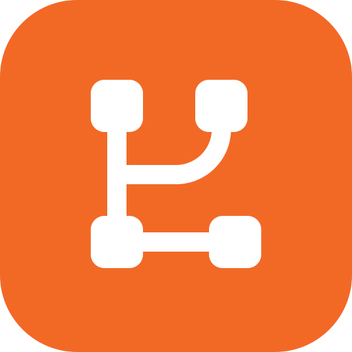

<div align="center">


# Megaladata Dock

Megaladata knowledge and tools for Codex and Hermes, built on OpenViking.

[Install and first steps](https://megaladata-dock.duckdns.org/) · [Plan](docs/plans/2026-09-02-megaladata-dock-implementation-plan.md) · [Architecture](docs/megaladata-dock/architecture.md) · [Development](docs/megaladata-dock/development.md) · [Status](docs/megaladata-dock/implementation-status.md)

</div>

Dock stores OpenViking resources, skills, search, memory, sessions, API, MCP, and Studio.
Work in Megaladata is performed by a connected agent with a local browser. The
`ai-skills`, `e2e-tests`, and `megaladata-help` repositories form Dock's shared knowledge base.

A preview [client release 0.1.0-rc.2](https://github.com/kartamyshev-dev/megaladata-dock/releases/tag/megaladata-dock%400.1.0-rc.2)
is published for macOS Apple Silicon, Linux x64, and Windows 11 x64. The Russian-language guide, agent
selection, archive links, and sample tasks are available on the [landing page](https://megaladata-dock.duckdns.org/).
Full Codex and Hermes scenarios have been verified.

## Build

For the next task, start with the [agent handoff note](docs/megaladata-dock/agent-handoff.md).
Current server paths, models, SSH, update, and rollback order are described in the
[operations guide](docs/megaladata-dock/operations.md).

Compose builds the server and Studio from this repository and stores data in a separate
Dock volume. A running Docker with Compose is required:

```sh
docker compose build
```

Initial setup of a separate config and startup is described in the
[developer guide](docs/megaladata-dock/development.md). By default the server
is published only on `127.0.0.1:1933`, Studio at `/studio/`, and MCP at `/mcp`.
The live HTTPS server is `https://megaladata.duckdns.org`; the separate landing page is
`https://megaladata-dock.duckdns.org`. Its sources and server build are described
in [landing/README.md](landing/README.md).

## Compatibility and origin

Megaladata Dock is a fork of [OpenViking](https://github.com/volcengine/OpenViking),
distributed under [AGPL-3.0](LICENSE). Copyright, internal package names,
storage format, `viking://` URIs, and OpenViking API headers are preserved.

- [Original OpenViking README](README_UPSTREAM.md)
- [Base feature documentation](docs/en/getting-started/01-introduction.md)
- [OpenViking Assets](docs/en/guides/18-openviking-assets.md)
- [Megaladata Dock source](https://github.com/kartamyshev-dev/megaladata-dock)
- [Issues and suggestions](https://github.com/kartamyshev-dev/megaladata-dock/issues)

Upstream plugin examples are kept for reuse. They are not ready-made Megaladata Dock
plugins and use their own OpenViking configuration.
